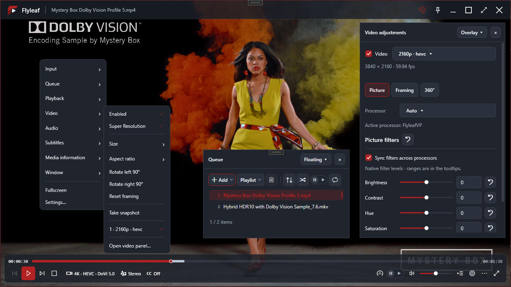

#  *lyleaf*

**High-performance Windows media player & .NET media engine**

Powered by **FFmpeg and DirectX**, Flyleaf combines a standalone media player with a powerful .NET playback library for WPF, WinUI and WinForms. Hardware-accelerated playback, advanced HDR and Dolby Vision support, and flexible UI controls are at its core.

[](https://github.com/SuRGeoNix/Flyleaf/releases/latest)
[](https://www.nuget.org/packages/FlyleafLib)
[](https://www.nuget.org/packages/FlyleafME)

**[Download Flyleaf](https://github.com/SuRGeoNix/Flyleaf/releases/latest)** · **[Get FlyleafLib on NuGet](https://www.nuget.org/packages/FlyleafLib)** · [Documentation](https://github.com/SuRGeoNix/Flyleaf/wiki) · [Samples](https://github.com/SuRGeoNix/Flyleaf/tree/master/Samples)



## Downloads & Packages

### Flyleaf — Media Player

A standalone Windows media player with hardware-accelerated playback, HDR/Dolby Vision support, playlists, subtitles, and configurable playback controls.

**[Download latest release](https://github.com/SuRGeoNix/Flyleaf/releases/latest)** · [All GitHub releases](https://github.com/SuRGeoNix/Flyleaf/releases)

### UI Controls

| Package | Description | Links |
|---|---|---|
| **FlyleafME** | Modern, customizable WPF Media Element control (.NET 10) | [NuGet / Release notes](https://www.nuget.org/packages/FlyleafME#releasenotes-body-tab) · [Quick start](FlyleafME/README.md) |
| **FlyleafME Legacy** (`FlyleafLib.Controls.WPF`) | Original WPF Media Element control | [NuGet / Release notes](https://www.nuget.org/packages/FlyleafLib.Controls.WPF#releasenotes-body-tab) |
| **FlyleafHost.WinUI** (`FlyleafLib.Controls.WinUI`) | Hardware-accelerated WinUI media surface | [NuGet / Release notes](https://www.nuget.org/packages/FlyleafLib.Controls.WinUI#releasenotes-body-tab) |

### Plugins

Extend FlyleafLib with support for web media, torrents and subtitle services. Each plugin is distributed separately through NuGet.

| Plugin | Description | Links |
|---|---|---|
| **YTDLP** | Play web media through yt-dlp, with optional browser cookie integration | [NuGet / Release notes](https://www.nuget.org/packages/FlyleafLib.Plugins.YTDLP#releasenotes-body-tab) · [GitHub](https://github.com/SuRGeoNix/Flyleaf.Plugins.YTDLP) |
| **BitSwarm** | Stream media directly from torrents without downloading them completely | [NuGet / Release notes](https://www.nuget.org/packages/FlyleafLib.Plugins.BitSwarm#releasenotes-body-tab) · [Source](https://github.com/SuRGeoNix/Flyleaf/tree/master/Plugins/BitSwarm) · [BitSwarm](https://github.com/SuRGeoNix/BitSwarm) |
| **OpenSubtitlesOrg** | Search for and download subtitles online | [NuGet / Release notes](https://www.nuget.org/packages/FlyleafLib.Plugins.OpenSubtitlesOrg#releasenotes-body-tab) · [Source](https://github.com/SuRGeoNix/Flyleaf/tree/master/Plugins/OpenSubtitlesOrg) |
| **SubtitlesConverter** | Detect and convert subtitle encodings to UTF-8 | [NuGet / Release notes](https://www.nuget.org/packages/FlyleafLib.Plugins.SubtitlesConverter#releasenotes-body-tab) · [Source](https://github.com/SuRGeoNix/Flyleaf/tree/master/Plugins/SubtitlesConverter) |

### FlyleafLib — Media Engine

The core .NET media library for applications that need fast, flexible audio and video playback through FFmpeg and DirectX.

**[NuGet / Release notes](https://www.nuget.org/packages/FlyleafLib#releasenotes-body-tab)**

## Overview

✅ **Play Everything** <sub>(Audio, Videos, Images, Playlists over any Protocol)</sub>

- *Extends FFmpeg's supported protocols and formats with additional plugins <sub>(YTDLP, BitSwarm)</sub>*
- *Accepts Custom I/O Streams and Plugins to handle non-standard protocols / formats*

✅ **Play it Smoothly** <sub>(Even with high resolutions 8K / HDR)</sub>
- *Coded from scratch to gain the best possible performance with FFmpeg & DirectX using video acceleration and custom pixel shaders*
- *Threading implementation with efficient cancellation which allows fast open, play, pause, stop, seek and stream switching*

✅ **Develop it Easy**
- *Provides a DPI aware, hardware accelerated Direct3D Surface (FlyleafHost) which can be hosted as normal control to your application and easily develop above it your own transparent overlay content*
- *All the implementation uses UI notifications (PropertyChanged / ObservableCollection etc.) so you can use it as a ViewModel directly*
- *For WPF, FlyleafME provides a composable playback UI with customizable controls and panels. [FlyleafME quick start](FlyleafME/README.md)*

## Features

### *FFmpeg*
- *HLS Live Seeking <sub>Supports seeking in live HLS streams</sub>*
- *Custom FFmpeg Builds <sub>Based on FFmpeg master (post-9.1 Gauss), with Flyleaf-specific optimizations and patches</sub>*
- *Additional Patches <sub>HLS persistent HTTP/HTTPS connections, Windows Schannel TLS 1.3, and MPEG-TS HEVC seeking</sub>*
- *Capture Devices <sub>Pass the format, input and options with a single URL, e.g. fmt://gdigrab?desktop&framerate=30</sub>*
- *FFmpeg ABI <sub>Uses [Flyleaf.FFmpeg.ABI](https://github.com/SuRGeoNix/Flyleaf.FFmpeg.ABI) bindings; use a compatible version for your FFmpeg binaries</sub>*
- *Recommended binaries and patch details: [Flyleaf FFmpeg Releases](https://github.com/SuRGeoNix/FFmpeg/releases)*
### *Playback*
- *Open / Play / Pause / Stop*
- *Speed / Reverse / Zero-Low Latency*
- *Seek Backward / Forward <sub>(Short / Medium / Large Step)</sub>*
- *Seek to Time / Seek to Frame / Seek to Chapter / Frame Stepping*
### *Video*
- *Enable / Disable*
- *Device Preference*
- *Aspect Ratio <sub>(Keep / Fill / Custom)</sub>*
- *Deinterlace <sub>(D3D11VP only - Supports double rate)</sub>*
- *Advanced HDR10 / HDR10+ / HLG / Dolby Vision <sub>(FlyleafVP only - All Dovi Profiles including L1/L3, L2/L8 trims, 7 FEL)</sub>*
- *Embedded ICC Profiles <sub>(FlyleafVP only)</sub>*
- *Pan Move / Zoom / Rotate / HFlip-VFlip / Cropping*
- *Record / Snapshot*
- *Super Resolution <sub>(D3D11VP only - Nvidia / Intel)</sub>*
- *360° Panoramic <sub>(FlyleafVP only)</sub>*
- *Video Acceleration*
- *Video Filters <sub>(Brightness / Contrast / Hue / Saturation)</sub>*
- *Video Processors <sub>(FlyleafVP / D3D11VP / SwsScale)</sub>*
- *VSync*
- *Zero-Copy <sub>(Crops with vertex shader)</sub>*
- *Split-Frame / Alpha Packing <sub>(FlyleafVP only - Special technique to support alpha with hardware acceleration)</sub>*
### *Audio*
- *Enable / Disable*
- *Device Preference*
- *Add / Remove Delay <sub>(Short / Large Step)</sub>*
- *Volume <sub>(Up / Down / Mute)</sub>*
- *Native Audio Formats <sub>(Sample Formats / Sample Rates / Channel Layouts)</sub>*
- *Languages support <sub>System's default languages as priorities for audio streams</sub>*
### *Subtitles*
- *Enable / Disable*
- *Add / Remove Delay <sub>(Short / Large Step)</sub>*
- *Bitmap Subtitles support*
- *Advanced Character Detection and Convert to UTF-8 <sub>SubtitlesConverter plugin</sub>*
- *Languages support <sub>System's default languages as priorities for subtitles streams</sub>*
### *UI Control (FlyleafHost)* <sub>*WPF / WinUI &amp; WinForms (Partially)*</sub>
- *Attach / Detach*
- *Activity / Idle Mode*
- *Drag Move <sub>(Self / Owner)</sub>*
- *Drag & Drop Swap*
- *Drag & Drop Open*
- *Full / Normal Screen*
- *Resize / Resize & Keep Ratio*
- *Z-Order*
### *UI Control (FlyleafME)* <sub>*WPF / .NET 10*</sub>

`FlyleafME` package · [Quick start](FlyleafME/README.md)

- *Customizable Playback Bar / Seek Bar / Context Menu*
- *Media Queue / Slideshow*
- *Docked / Floating / Overlay Panels <sub>(Playback, Video, Audio, Subtitles, Media Information, Queue, Settings)</sub>*
- *Customizable Subtitle Text / On-Screen Display*
- *Dark / Light / System Themes with Accent Colors*
### *UI Control (FlyleafME Legacy)* <sub>*WPF / .NET 8 and .NET 10*</sub>

`FlyleafLib.Controls.WPF` package

- *Flyleaf Bar Control / Slider*
- *Flyleaf Popup Menu*
- *Flyleaf Settings Dialog*
- *Color Themes <sub>Based on Material Design in XAML</sub>*
- *Style / Control Template Customization*
### Misc.
- *Mouse & Key Bindings <sub>All the implementation supports customizable mouse & key bindings which can be assigned to an embedded or a custom actions (find defaults [here](https://github.com/SuRGeoNix/Flyleaf/wiki/Player-(Key-&-Mouse-Bindings)))</sub>*
- *Audio Player <sub>Can be used as an audio player only without the need of UI Control</sub>*
- *Downloader / Remuxer <sub>The library can be used also for downloading & remuxing</sub>*
- *Extractor <sub>The library can be used also for extracting video frames (supports also by X frames Step)</sub>*

## Building from Source

FFmpeg native binaries are no longer included in the repository. They are distributed separately through [Flyleaf FFmpeg releases](https://github.com/SuRGeoNix/FFmpeg/releases).

After cloning the repository, run `Download-FFmpeg.bat` from the repository root to download the recommended FFmpeg build into the `FFmpeg/` directory.

```powershell
git clone https://github.com/SuRGeoNix/Flyleaf.git
cd Flyleaf
.\Download-FFmpeg.bat
```

The script downloads a pinned Windows x64 LGPL shared build, ensuring consistent FFmpeg versions across development environments. Running it again replaces the existing FFmpeg binaries.

Once downloaded, open `FlyleafLib.sln` in Visual Studio to build the library and samples.

> **Repository history update (November 2026):** Git history was rewritten to remove obsolete binaries and media assets, reducing packed storage by approximately 98.5%. If you cloned or forked Flyleaf before the rewrite, a fresh clone is recommended. Existing forks or branches based on the old history may need to be recreated or rebased.

## Thanks to

*Flyleaf wouldn't exist without them!*
* *For the Core*
  * ***[FFmpeg](http://ffmpeg.org/)*** / ***[Flyleaf.FFmpeg.ABI](https://github.com/SuRGeoNix/Flyleaf.FFmpeg.ABI)***
  * DirectX / ***[Vortice](https://github.com/amerkoleci/Vortice.Windows)***
  * *Major open source media players* ***[FFplay](https://github.com/FFmpeg/FFmpeg/blob/master/fftools/ffplay.c)***, ***[Kodi](https://github.com/xbmc/xbmc)***, ***[Libplacebo](https://github.com/haasn/libplacebo)***, ***[MPCVR](https://github.com/Aleksoid1978/VideoRenderer/)***, ***[MPV](https://github.com/mpv-player/mpv)***, ***[VLC](https://github.com/videolan/vlc)***

* *For the Plugins*
  * ***[BitSwarm](https://github.com/SuRGeoNix/BitSwarm)***
  * ***[OpenSubtitles.org](https://www.opensubtitles.org/)***
  * ***[YT-DLP](https://github.com/yt-dlp/yt-dlp)*** / ***[Flyleaf.Plugins.YTDLP](https://github.com/SuRGeoNix/Flyleaf.Plugins.YTDLP)***
